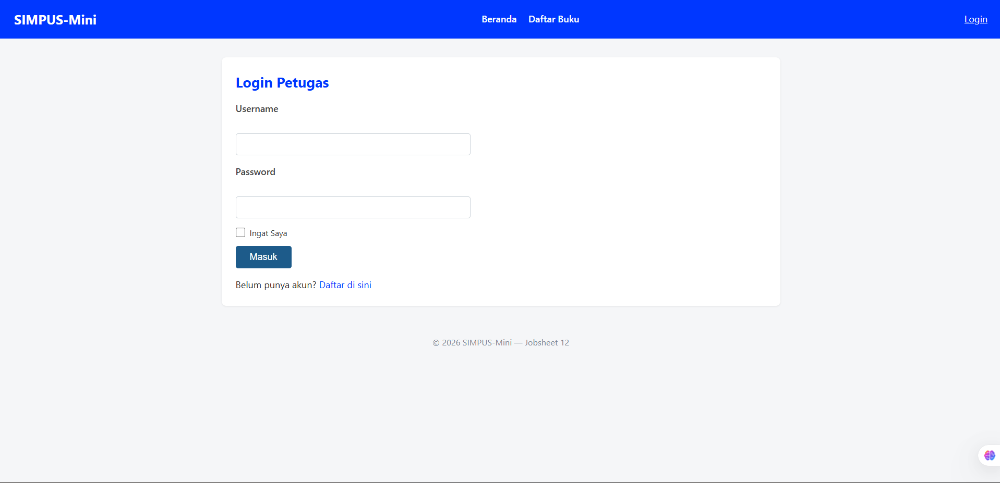
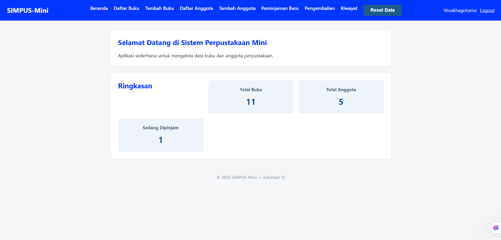
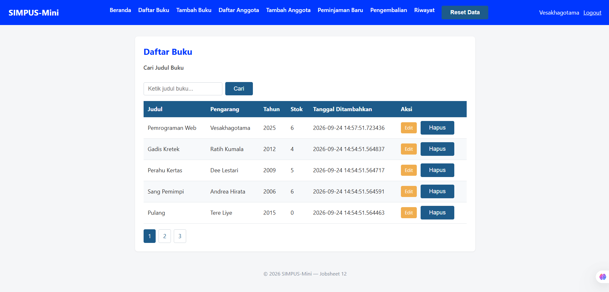
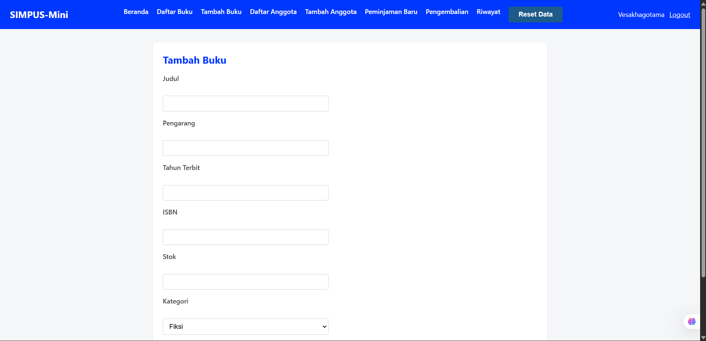
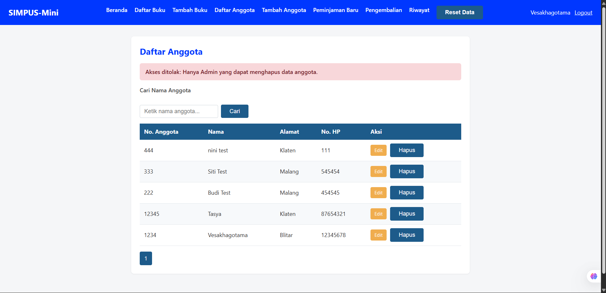
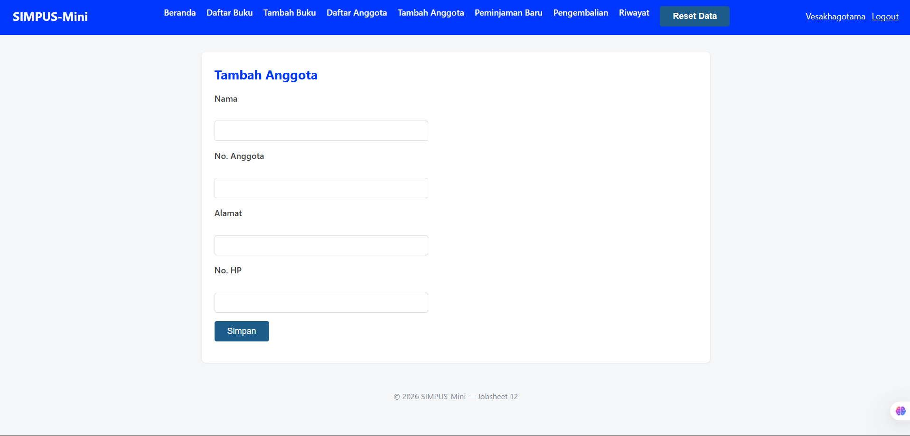
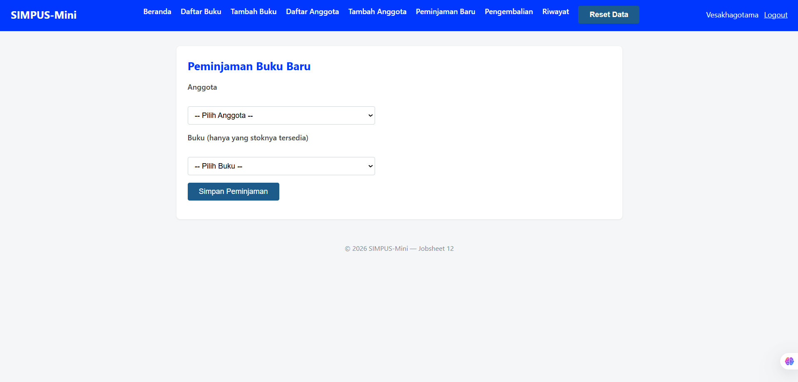
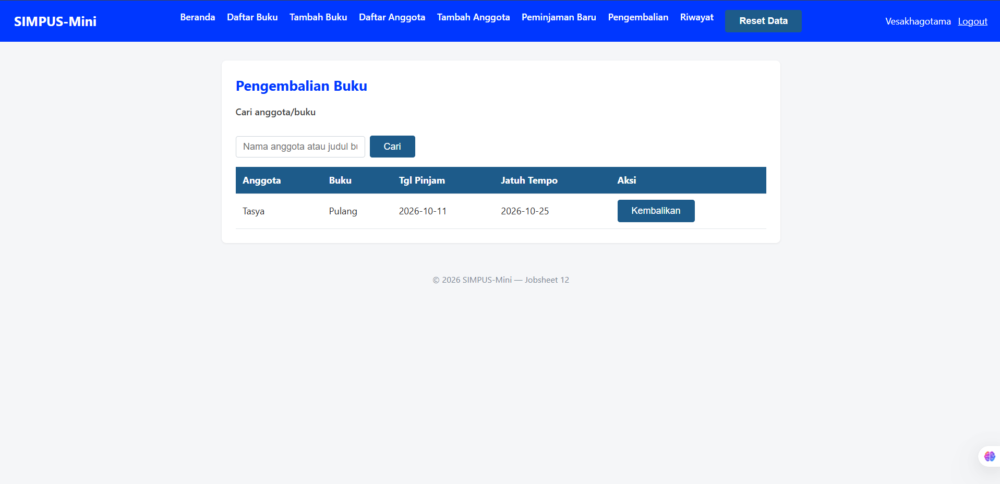
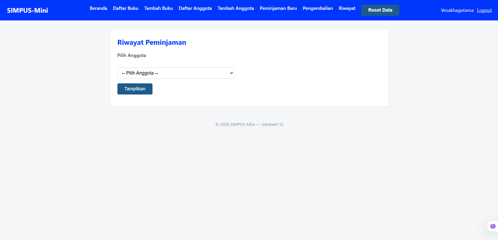
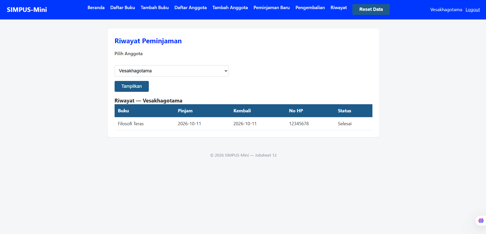

# 📖 Manual Pengguna SIMPUS-Mini

Selamat datang di panduan penggunaan Sistem Informasi Perpustakaan Mini (SIMPUS-Mini). Dokumen ini akan membantu Anda memahami alur kerja dan cara menggunakan berbagai fitur yang tersedia di dalam aplikasi.

---

## 1. Otentikasi & Akses Sistem

### 1.1 Login Petugas
Untuk mengakses sistem, petugas perpustakaan harus melakukan login menggunakan kredensial yang valid. Halaman ini dilengkapi dengan pengamanan CSRF untuk mencegah serangan pemalsuan *request*.

---

## 2. Dasbor (Beranda)

Setelah berhasil login, Anda akan diarahkan ke halaman **Beranda**. Halaman ini menampilkan ringkasan informasi penting perpustakaan secara *real-time*, seperti:
- Total jumlah buku yang terdaftar.
- Total anggota perpustakaan aktif.
- Jumlah buku yang saat ini sedang dipinjam.

---

## 3. Manajemen Buku

### 3.1 Daftar Buku
Halaman ini menampilkan seluruh koleksi buku yang ada di perpustakaan. Anda dapat melihat informasi detail buku (Kode, Judul, Pengarang, Tahun Terbit) beserta status ketersediaannya (Stok / Dipinjam). Tersedia juga fitur **Pencarian** untuk menemukan buku dengan cepat.

### 3.2 Tambah Buku
Jika ada koleksi buku baru, petugas dapat menambahkannya melalui form ini. Pastikan untuk mengisi semua kolom wajib seperti Judul, Pengarang, dan Tahun Terbit.

---

## 4. Manajemen Anggota

### 4.1 Daftar Anggota
Halaman ini digunakan untuk mengelola data keanggotaan. Menampilkan nomor anggota, nama, dan alamat. 

### 4.2 Tambah Anggota
Formulir untuk mendaftarkan anggota baru ke dalam sistem perpustakaan. Nomor Anggota harus unik.

---

## 5. Sirkulasi (Peminjaman & Pengembalian)

### 5.1 Peminjaman Buku Baru
Fitur ini digunakan ketika ada anggota yang ingin meminjam buku. Petugas memilih nama anggota dan buku yang akan dipinjam dari *dropdown*. Sistem akan otomatis memvalidasi apakah stok buku masih tersedia dan memastikan proses berjalan aman menggunakan *Database Transaction*.

### 5.2 Pengembalian Buku
Halaman ini menampilkan daftar transaksi peminjaman yang sedang aktif (buku belum dikembalikan). Petugas dapat menekan tombol **Kembalikan** ketika anggota membawa kembali buku tersebut. Sistem akan otomatis mencatat tanggal kembali dan mengembalikan stok buku.

---

## 6. Riwayat Peminjaman

### 6.1 Memilih Anggota
Untuk melihat rekam jejak peminjaman, petugas pertama-tama memilih nama anggota dari *dropdown* pada halaman pencarian riwayat.

### 6.2 Daftar Riwayat Peminjaman Lengkap
Setelah anggota dipilih, sistem akan menampilkan tabel riwayat peminjaman lengkap untuk anggota tersebut, baik buku yang masih dipinjam maupun yang sudah dikembalikan.

---
*Dokumentasi ini dibuat sebagai bagian dari penyelesaian Proyek Final SIMPUS-Mini.*